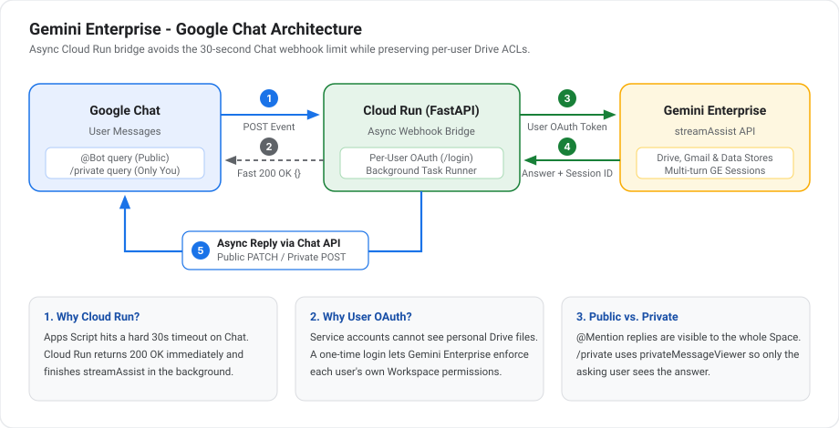

# Gemini Enterprise Google Chat App (Cloud Run)

[한국어 가이드](./README.md)

A Cloud Run Google Chat bot sample that connects Google Chat to Gemini Enterprise via the `streamAssist` API.

---

## Why This Setup?

Gemini Enterprise and Google Chat speak different protocols, so a lightweight bridge service is needed between them.

1. **Avoiding the 30-second Apps Script timeout**
   The official Apps Script quickstart hits Google Chat's hard 30-second execution limit whenever Drive search or multi-step reasoning takes longer than half a minute. Running the bridge on Cloud Run lets the app return `200 OK` immediately and finish the `streamAssist` call asynchronously in the background.
2. **Preserving personal Google Drive permissions**
   A Cloud Run service account has no access to individual users' Drive files. This app uses a one-time OAuth 2.0 login per user so Gemini Enterprise checks document permissions under the asking user's own identity.
3. **Public and private answers in one Space**
   Mentioning `@Bot` posts the answer for everyone in the Space. Using the `/private` slash command sends the reply with `privateMessageViewer` so only the asking user can see it.

---

## Architecture



---

## Repository Structure

All files required for Cloud Run deployment live inside `app/`. Download or clone the repo and deploy straight from that folder.

```text
ge-google-chat-app/
├── README.md                 # Korean setup guide
├── README.en.md              # English setup guide
├── docs/
│   ├── architecture-ko.svg   # Architecture diagram (Korean)
│   └── architecture-en.svg   # Architecture diagram (English)
└── app/                      # Deployable Cloud Run source files
    ├── main.py               # FastAPI webhook server
    ├── requirements.txt      # Python dependencies
    ├── Procfile              # Cloud Run entrypoint
    └── .env.example          # Environment variable template
```

---

## Prerequisites

1. A Google Cloud project with billing enabled
2. A Google Workspace account with Google Chat access
3. A Gemini Enterprise app configured with Google Identity and connected data stores
4. `gcloud` CLI installed locally or Google Cloud Shell

---

## Step-by-Step Setup

### Step 1. Enable Required APIs

```bash
export PROJECT_ID="your-gcp-project-id"
gcloud config set project "$PROJECT_ID"

gcloud services enable \
  run.googleapis.com \
  cloudbuild.googleapis.com \
  artifactregistry.googleapis.com \
  chat.googleapis.com \
  discoveryengine.googleapis.com
```

### Step 2. Configure OAuth Consent and Client

1. Open **Google Auth Platform > Branding** in Google Cloud Console, set your app name and support email, and choose **Internal** for Audience.
2. Open **Google Auth Platform > Data Access > Add or remove scopes** and add:
   ```text
   https://www.googleapis.com/auth/discoveryengine.assist.readwrite
   ```
3. Open **Google Auth Platform > Clients > + Create client**:
   - **Application type:** Web application
   - **Name:** `ge-chat-bot-oauth`
   - **Authorized redirect URIs:** Leave blank for now and add it right after Step 3.
4. Copy the generated **Client ID** and **Client Secret**.

### Step 3. Deploy to Cloud Run

First, open **Gemini Enterprise > Apps** in Google Cloud Console and note your app's **ID** (`GE_APP_ID`) and **Location** (`global`, `us`, or `eu`).

Move into the `app/` directory and deploy with a single command. Replace the `<...>` placeholders with your own values.

```bash
cd app

gcloud run deploy ge-chat-bot \
  --source . \
  --region asia-northeast3 \
  --no-cpu-throttling \
  --allow-unauthenticated \
  --max-instances=1 \
  --set-env-vars "GE_PROJECT=${PROJECT_ID},GE_LOCATION=global,GE_APP_ID=<GE_APP_ID>,SERVICE_URL=https://placeholder.run.app,OAUTH_CLIENT_ID=<OAUTH_CLIENT_ID>,OAUTH_CLIENT_SECRET=<OAUTH_CLIENT_SECRET>"
```

Copy the **Service URL** printed after deployment (for example, `https://ge-chat-bot-xxxx.a.run.app`), then finish two quick updates:

1. Return to your OAuth client from Step 2 and add `<SERVICE_URL>/callback` under **Authorized redirect URIs**.
2. Update `SERVICE_URL` on Cloud Run:
   ```bash
   gcloud run services update ge-chat-bot \
     --region asia-northeast3 \
     --update-env-vars "SERVICE_URL=<SERVICE_URL>"
   ```

> **Note:** `--no-cpu-throttling` keeps the background task alive after the immediate `200 OK` response. `--max-instances=1` is used because this sample keeps tokens and session IDs in memory; swap them to Firestore before scaling out in production.

### Step 4. Configure Google Chat API

1. Open **APIs & Services > Google Chat API > Configuration** in Google Cloud Console.
2. Fill in the settings:
   - **App name:** `Gemini Enterprise Chat`
   - **Avatar URL:** Any public icon URL
   - **Description:** `Gemini Enterprise assistant for Google Chat`
   - **Interactive features:** Enabled
   - **Functionality:** Check **Join spaces and group conversations**
   - **Connection settings:** Choose **HTTP endpoint URL** and paste your Cloud Run **Service URL**
   - **Slash commands:** Click `+ Add slash command`
     - **Name:** `/private`
     - **Command ID:** `1`
     - **Description:** `Ask Gemini Enterprise privately`
   - **Visibility:** Add test user emails or a Google Group
   - **App status:** Select `Live - available to users`
3. Click **Save**.

---

## Usage

1. Refresh Google Chat. Start a 1:1 DM with `Gemini Enterprise Chat`, or invite it to a Space via **Space name > Apps & integrations > Add apps**.
   - Google Chat does not allow bots in regular group DMs; use a Space instead.
2. Send your first message and click the one-time OAuth login link returned by the bot.
3. Use either mode:
   - **Public in a Space:** `@Gemini Enterprise Chat Find our onboarding guide in Drive`
   - **Private in a Space:** `/private Summarize my latest Drive documents`
   - **Start a fresh session:** `/reset`

> **Security note:** Asking about personal Drive documents via `@mention` posts the summary to the entire Space. Use 1:1 DMs or `/private` for personal files.

---

## FAQ

### Do I need a database to keep multi-turn chat sessions?
Gemini Enterprise stores the conversation history inside its own session resource. Your app only maps `(space, user)` to a GE session ID alongside user OAuth tokens, so two small Cloud Firestore collections are enough for production.

### Can I run multiple Chat bots in a single GCP project?
Google Chat API enforces one Chat app per GCP project. To offer multiple agents, route them with slash commands inside one bot or point lightweight shell projects to routes on the same Cloud Run service.

### What should I harden before production rollout?
Verify the Google Chat `Authorization: Bearer` JWT inside `handle_chat_event` using `google.oauth2.id_token.verify_oauth2_token`, and replace the in-memory dictionaries with Firestore.
