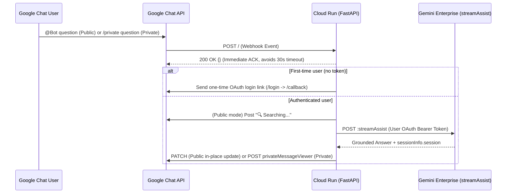

# Gemini Enterprise Google Chat Bot (Cloud Run)

> [한국어 가이드 (README.md)](./README.md)

An asynchronous **Cloud Run-based Google Chat App** that connects **Google Chat** directly to **Gemini Enterprise** (`streamAssist` API).

Unlike Apps Script quickstarts that hit Google Chat's **30-second execution timeout**, this Cloud Run implementation acknowledges webhooks immediately, runs `streamAssist` asynchronously in the background, preserves **per-user ACLs** via OAuth 2.0 (for personal Google Drive / Workspace connectors), and supports both **public (`@mention`)** and **private (`/private`)** responses in the same Google Chat space.

---

## Key Features

- **No 30-Second Timeout:** Immediately returns `200 OK {}` to Google Chat and runs Gemini Enterprise `streamAssist` asynchronously before posting the final answer via the Google Chat REST API.
- **Per-User ACL Enforcement (OAuth 2.0):** Calls `streamAssist` using each user's own OAuth token (`discoveryengine.assist.readwrite`) rather than a shared service account, preserving document-level permissions across Google Drive, Gmail, and enterprise connectors.
- **Public & Private Dual Mode:**
  - **Public (`@Bot question`):** Posts a `"🔍 Searching..."` placeholder and updates it in-place (`PATCH`) for everyone in the space.
  - **Private (`/private question`):** Uses Google Chat's `privateMessageViewer` field so the response is visible **only to the requesting user**.
- **Multi-Turn GE Session Support:** Reuses the Gemini Enterprise `sessionInfo.session` returned by `streamAssist` for multi-turn context, with `/reset` to start a new session.

---

## Architecture



---

## Prerequisites

1. A **Google Cloud project** with billing enabled.
2. A **Google Workspace** domain with Google Chat enabled.
3. A configured **Gemini Enterprise App** using Google Identity (with Google Drive or other Data Stores connected).
4. `gcloud` CLI installed (or **Cloud Shell** in Google Cloud Console).

---

## Step-by-Step Setup Guide

### Step 1. Enable Required APIs

```bash
export PROJECT_ID="your-gcp-project-id"
gcloud config set project "$PROJECT_ID"

gcloud services enable \
  run.googleapis.com \
  cloudbuild.googleapis.com \
  chat.googleapis.com \
  discoveryengine.googleapis.com
```

### Step 2. Configure OAuth Consent Screen & Web Client

1. In Google Cloud Console, go to **Google Auth Platform > Branding**, configure app name & support email, and set **Audience** to **Internal**.
2. Go to **Google Auth Platform > Data Access > Add or remove scopes** and add:
   ```text
   https://www.googleapis.com/auth/discoveryengine.assist.readwrite
   ```
3. Go to **Google Auth Platform > Clients > `+ Create client`**:
   - **Application type:** `Web application`
   - **Name:** `ge-chat-bot-oauth`
   - **Authorized redirect URIs:** Add `https://<CLOUD_RUN_URL>/callback` right after Step 3.
4. Save the generated **Client ID** and **Client Secret**.

### Step 3. Deploy to Cloud Run (Single Command, No Git Required)

Run the following command from this repository directory (replace `<...>` placeholders):

```bash
gcloud run deploy ge-chat-bot \
  --source . \
  --region asia-northeast3 \
  --no-cpu-throttling \
  --allow-unauthenticated \
  --max-instances=1 \
  --set-env-vars "GE_PROJECT=${PROJECT_ID},GE_LOCATION=global,GE_APP_ID=<GE_APP_ID>,SERVICE_URL=https://placeholder.run.app,OAUTH_CLIENT_ID=<OAUTH_CLIENT_ID>,OAUTH_CLIENT_SECRET=<OAUTH_CLIENT_SECRET>"
```

Copy the resulting **`Service URL`** (e.g., `https://ge-chat-bot-xxxxxxxxxx-du.a.run.app`), then:

1. **Register Redirect URI:** In your OAuth client from Step 2, add `https://<SERVICE_URL>/callback` under **Authorized redirect URIs** and save.
2. **Update `SERVICE_URL` on Cloud Run:**
   ```bash
   gcloud run services update ge-chat-bot \
     --region asia-northeast3 \
     --update-env-vars "SERVICE_URL=https://<SERVICE_URL>"
   ```

> **Why `--no-cpu-throttling` and `--max-instances=1`?**
> - `--no-cpu-throttling`: Keeps CPU allocated after the immediate `{}` response so the background `streamAssist` request completes reliably.
> - `--max-instances=1`: This sample stores OAuth tokens and session IDs in memory (`USER_TOKENS`, `CHAT_SESSIONS`) for simplicity. For production multi-instance scaling, persist them in **Firestore**.

### Step 4. Configure Google Chat API

1. In Google Cloud Console, go to **APIs & Services > Google Chat API > Configuration**.
2. Configure:
   - **App name:** `Gemini Enterprise Chat`
   - **Avatar URL:** Any public icon URL
   - **Description:** `Gemini Enterprise Assistant for Google Chat`
   - **Interactive features:** Turn **ON**
   - **Functionality:** Check **Join spaces and group conversations**
   - **Connection settings:** Select **HTTP endpoint URL** and paste your Cloud Run **`Service URL`**
   - **Slash commands (for private mode):** Click `+ Add slash command`
     - **Name:** `/private`
     - **Command ID:** `1`
     - **Description:** `Ask Gemini Enterprise privately (visible only to you)`
   - **Visibility:** Add test users/groups (or publish internally via Google Workspace Marketplace SDK for org-wide access)
3. Click **Save**.

---

## Usage

1. Refresh Google Chat. Start a **1:1 DM** with `Gemini Enterprise Chat`, or add it to a Space via **Space Name > Apps & integrations > Add apps**.
2. On your first message, the bot replies with a one-time **OAuth login link**. Click it and grant access.
3. Interact in either mode:
   - **Public (Space):** `@Gemini Enterprise Chat Find our project guidelines in Drive`
   - **Private (Space):** `/private Summarize my latest Drive docs`
   - **Reset session:** `/reset`

> **Security Note:** Using public `@mention` mode with per-user OAuth will post summaries of documents accessible to the requester into the shared space. Recommend **1:1 DM** or **`/private`** for personal or confidential Drive queries.

---

## Production Considerations & FAQ

- **Q. Do I need a database to keep multi-turn chat sessions?**
  - Conversation history itself is managed inside **Gemini Enterprise Sessions** (`sessionInfo.session`). You only need a lightweight key-value mapping (`(space, user) -> session_id`) plus user OAuth tokens. For production multi-instance Cloud Run deployments, store these two small collections in **Cloud Firestore** (no relational DB required).
- **Q. Can I host multiple Chat bots in one GCP project?**
  - Google Chat API enforces a **1:1 mapping between GCP projects and Chat apps**. To expose multiple agents, route them via slash commands inside one bot, or use lightweight shell projects pointing to routes on the same Cloud Run backend.
- **Q. How should I secure the Cloud Run endpoint in production?**
  - Verify the Google Chat `Authorization: Bearer <JWT>` token signature and audience (`aud`) inside `handle_chat_event` using `google.oauth2.id_token.verify_oauth2_token`.
