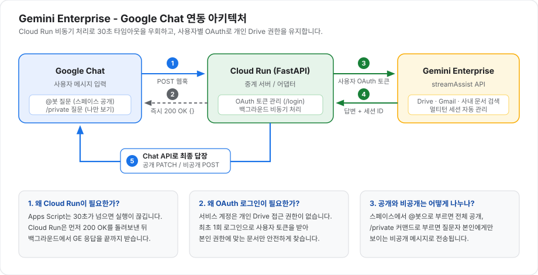

# Gemini Enterprise Google Chat App (Cloud Run)

[English Guide](./README.en.md)

Google Chat 안에서 Gemini Enterprise를 바로 불러다 쓸 수 있게 연결해 주는 Cloud Run 봇 샘플입니다.

---

## 왜 이렇게 구성했나요?

Gemini Enterprise 웹앱은 이미 떠 있지만 Google Chat과 쓰는 프로토콜이 달라서 중간에 요청을 받아 넘겨주는 중계 앱이 하나 필요합니다.

1. **Apps Script 30초 타임아웃 문제**
   Google 공식 퀵스타트에서 안내하는 Apps Script 방식은 Google Chat 이벤트 실행 시간이 30초로 고정되어 있습니다. Google Drive 검색이나 답변 생성이 조금만 길어져도 `Exceeded maximum execution time` 에러로 응답이 끊깁니다. Cloud Run을 쓰면 먼저 Google Chat에 `200 OK`를 바로 돌려보낸 뒤 백그라운드에서 답변이 끝날 때까지 기다렸다가 Chat API로 보낼 수 있습니다.
2. **개인 Google Drive 권한 문제**
   Cloud Run 기본 서비스 계정으로 Gemini Enterprise를 부르면 서비스 계정에는 사용자의 개인 Drive 권한이 없어서 파일이 검색되지 않습니다. 이 앱은 최초 1회 OAuth 로그인으로 질문한 사람 본인의 토큰을 받아 호출하므로 본인이 볼 수 있는 문서만 안전하게 검색합니다.
3. **스페이스 공개와 비공개 병행**
   같은 채팅방 안에서 `@봇이름 질문`으로 부르면 방 전체에 답변이 공유되고 `/private 질문`으로 부르면 질문한 본인 눈에만 보이는 비공개 메시지로 답합니다.

---

## 아키텍처



---

## 폴더 구조

배포할 때 필요한 파일은 모두 `app/` 폴더 안에 모아 두었습니다. Cloud Shell이나 로컬에서 `app/` 폴더만 내려받아 그대로 배포하면 됩니다.

```text
ge-google-chat-app/
├── README.md                 # 한국어 설정 가이드
├── README.en.md              # 영어 설정 가이드
├── docs/
│   ├── architecture-ko.svg   # 아키텍처 다이어그램 (한국어)
│   └── architecture-en.svg   # 아키텍처 다이어그램 (영어)
└── app/                      # Cloud Run 배포용 파일 모음
    ├── main.py               # FastAPI 봇 서버
    ├── requirements.txt      # 파이썬 패키지 목록
    ├── Procfile              # Cloud Run 실행 명령
    └── .env.example          # 환경변수 예시
```

---

## 사전 준비

시작하기 전에 아래 4가지가 준비되어 있어야 합니다.

1. 결제가 연결된 Google Cloud 프로젝트
2. Google Chat을 쓸 수 있는 Google Workspace 계정
3. Google Identity로 설정된 Gemini Enterprise 앱과 연결된 데이터 스토어
4. `gcloud` CLI가 설치된 터미널 또는 Google Cloud Console의 Cloud Shell

---

## 단계별 설정 가이드

### 1단계. 필수 API 켜기

Cloud Shell이나 터미널에서 사용할 Google Cloud 프로젝트를 지정하고 필요한 API 4개를 켭니다.

```bash
export PROJECT_ID="your-gcp-project-id"
gcloud config set project "$PROJECT_ID"

gcloud services enable \
  run.googleapis.com \
  cloudbuild.googleapis.com \
  chat.googleapis.com \
  discoveryengine.googleapis.com
```

### 2단계. OAuth 동의 화면과 클라이언트 만들기

사용자가 본인 계정으로 Google Drive를 검색할 수 있도록 OAuth 인증을 설정합니다.

1. Google Cloud Console에서 **Google Auth Platform > Branding**으로 들어가 앱 이름과 지원 이메일을 입력합니다.
2. **Audience**는 **Internal**로 선택합니다.
3. **Google Auth Platform > Data Access > Add or remove scopes**에서 아래 스코프를 추가하고 저장합니다.
   ```text
   https://www.googleapis.com/auth/discoveryengine.assist.readwrite
   ```
4. **Google Auth Platform > Clients > + Create client**를 누르고 아래처럼 만듭니다.
   - **Application type:** Web application
   - **Name:** `ge-chat-bot-oauth`
   - **Authorized redirect URIs:** 비워 두고 다음 단계에서 Cloud Run 주소가 나오면 추가합니다.
5. 생성된 **Client ID**와 **Client Secret**을 복사해 둡니다.

### 3단계. Cloud Run 배포

이 리포지토리를 내려받은 뒤 `app/` 폴더로 들어가서 아래 명령을 실행합니다. `<...>` 부분은 본인 환경 값으로 바꿔 주세요.

```bash
cd app

gcloud run deploy ge-chat-bot \
  --source . \
  --region asia-northeast3 \
  --no-cpu-throttling \
  --allow-unauthenticated \
  --max-instances=1 \
  --set-env-vars "GE_PROJECT=${PROJECT_ID},GE_LOCATION=global,GE_APP_ID=<GE_APP_ID>,SERVICE_URL=https://placeholder.run.app,OAUTH_CLIENT_ID=<OAUTH_CLIENT_ID>,OAUTH_CLIENT_SECRET=<OAUTH_CLIENT_SECRET>"
```

배포가 끝나면 터미널에 출력되는 **Service URL**을 복사한 뒤 두 가지를 마무리합니다.

1. 2단계에서 만든 OAuth 클라이언트 설정으로 돌아가 **Authorized redirect URIs**에 `https://<SERVICE_URL>/callback`을 추가하고 저장합니다.
2. Cloud Run의 `SERVICE_URL` 환경변수를 실제 주소로 바꿉니다.
   ```bash
   gcloud run services update ge-chat-bot \
     --region asia-northeast3 \
     --update-env-vars "SERVICE_URL=https://<SERVICE_URL>"
   ```

> **참고:** `--no-cpu-throttling`은 Google Chat에 먼저 응답을 보낸 뒤에도 백그라운드 작업이 멈추지 않게 하기 위한 옵션입니다. `--max-instances=1`은 이 샘플이 테스트 편의를 위해 토큰과 세션을 메모리에 저장하기 때문에 붙였습니다. 실제 운영 환경에서는 Firestore로 저장소를 바꾸고 인스턴스 제한을 푸는 것을 권장합니다.

### 4단계. Google Chat API 설정

1. Google Cloud Console에서 **APIs & Services > Google Chat API > Configuration**으로 이동합니다.
2. 아래 항목을 입력합니다.
   - **App name:** `Gemini Enterprise Chat`
   - **Avatar URL:** 사용할 아이콘 이미지 주소
   - **Description:** `Google Chat용 Gemini Enterprise 봇`
   - **Interactive features:** 켜기
   - **Functionality:** 스페이스에서도 쓰려면 **Join spaces and group conversations** 체크
   - **Connection settings:** **HTTP endpoint URL** 선택 후 3단계의 Cloud Run **Service URL** 입력
   - **Slash commands:** `+ Add slash command` 클릭
     - **Name:** `/private`
     - **Command ID:** `1`
     - **Description:** `나만 보이는 비공개 질문`
   - **Visibility:** 함께 테스트할 사람이나 Google Group 이메일 추가
3. **Save**를 누릅니다.

---

## 사용 방법

1. Google Chat 페이지를 새로고침한 뒤 `Gemini Enterprise Chat`과 1:1 대화를 열거나 스페이스 상단의 **앱 및 통합 > 앱 추가**에서 봇을 초대합니다.
   - 일반 그룹챗에서는 Google Chat 정책상 봇을 초대할 수 없고 스페이스에서만 가능합니다.
2. 첫 메시지를 보내면 봇이 로그인 링크를 보내 줍니다. 링크를 눌러 본인 Google 계정으로 승인하면 끝입니다.
3. 이후 상황에 맞게 두 가지 방식으로 쓰면 됩니다.
   - **모두에게 보이기:** `@Gemini Enterprise Chat 내 드라이브에서 프로젝트 가이드 찾아줘`
   - **나만 보기:** `/private 내 드라이브 최신 문서 요약해줘`
   - **대화 맥락 초기화:** `/reset`

> **보안 주의:** 스페이스에서 `@멘션`으로 개인 Drive 문서를 물어보면 답변이 방의 다른 사람들에게도 보입니다. 개인 문서를 찾을 때는 1:1 DM이나 `/private` 커맨드를 사용해 주세요.

---

## 자주 묻는 질문

### 대화 맥락을 유지하려면 DB를 따로 구축해야 하나요?
대화 내용 자체는 Gemini Enterprise 내부 세션이 기억합니다. 앱은 채팅방과 GE 세션 ID의 매핑 한 줄과 사용자 OAuth 토큰만 들고 있으면 되므로 별도 RDB 없이 Cloud Firestore 컬렉션 두 개만 붙이면 운영 환경에서도 깔끔하게 동작합니다.

### GCP 프로젝트 하나에 Chat 봇을 여러 개 만들 수 있나요?
Google Chat API는 GCP 프로젝트 하나당 봇 하나만 허용합니다. 에이전트가 여러 개라면 봇 하나 안에서 슬래시 커맨드로 나누거나 Chat API만 켠 별도 프로젝트들을 같은 Cloud Run 주소로 연결하는 방식을 씁니다.

### 실제 운영 환경에 올릴 때 추가로 챙길 보안 설정은 무엇인가요?
`app/main.py`의 `handle_chat_event`에서 Google Chat이 보내는 `Authorization: Bearer` JWT 서명을 `google.oauth2.id_token.verify_oauth2_token`으로 검증하는 코드를 추가하고 인메모리 딕셔너리 대신 Firestore를 사용하세요.
