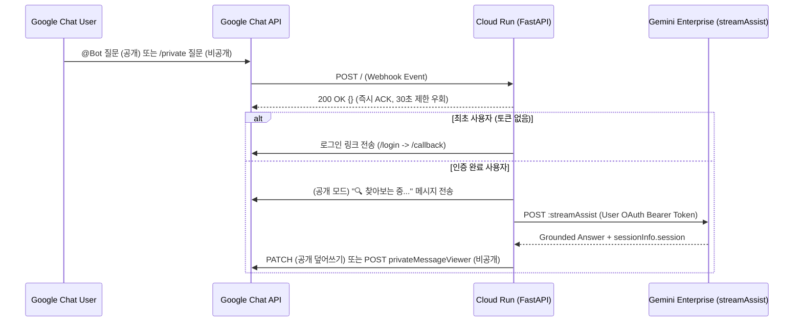

# Gemini Enterprise Google Chat Bot (Cloud Run)

> [English Guide (README.en.md)](./README.en.md)

**Google Chat**에서 **Gemini Enterprise** 기본 어시스턴트(또는 커스텀 에이전트)를 직접 호출할 수 있는 **Cloud Run 기반 비동기 Google Chat 앱** 샘플입니다.

Apps Script 기반 퀵스타트의 **30초 실행 시간 제한**을 해결하고, **사용자별 OAuth 2.0 인증**을 통해 개인 Google Drive / Workspace ACL 권한을 그대로 유지하면서, 하나의 스페이스에서 **공개(`@멘션`)**와 **비공개(`/private`)** 모드를 병행할 수 있습니다.

---

## 주요 기능

- **30초 타임아웃 완전 해결:** Google Chat 웹훅을 0.1초 내에 즉시 응답(`{}`)하고, Cloud Run 백그라운드 태스크에서 Gemini Enterprise `streamAssist` API를 끝까지 실행한 뒤 Google Chat REST API로 최종 답장을 전송합니다.
- **사용자별 ACL 보안 유지 (Per-User OAuth 2.0):** 서비스 계정이 아닌 질문자 본인의 OAuth 토큰(`discoveryengine.assist.readwrite`)으로 `streamAssist`를 호출하므로, 사용자가 접근 권한을 가진 Google Drive / Gmail / 사내 데이터스토어만 안전하게 검색합니다.
- **공개 / 비공개 병행 지원:**
  - **공개 모드 (`@봇이름 질문`):** `"🔍 Gemini Enterprise에서 찾아보는 중..."` 메시지를 띄운 뒤 완료 시 해당 메시지를 실제 답변으로 덮어쓰기(`PATCH`)하여 스페이스 전체에 공유합니다.
  - **비공개 모드 (`/private 질문`):** `privateMessageViewer`를 사용해 질문한 본인에게만 보이는 비공개 답변을 전송합니다.
- **멀티턴 대화 세션 유지:** Gemini Enterprise가 생성하는 `sessionInfo.session`을 재사용해 연속 대화를 지원하며, `/reset`으로 세션을 초기화할 수 있습니다.

---

## 아키텍처



---

## 사전 준비 (Prerequisites)

1. 결제가 활성화된 **Google Cloud 프로젝트**
2. **Google Workspace** 계정 및 Google Chat 사용 권한
3. 생성 및 설정이 완료된 **Gemini Enterprise 앱** (Google Identity 연동 + Google Drive 등 필요한 Data Store 연결 완료)
4. `gcloud` CLI 설치 또는 Google Cloud Console의 **Cloud Shell**

---

## Step-by-Step 설정 가이드

### Step 1. 필수 Google Cloud API 활성화

```bash
export PROJECT_ID="your-gcp-project-id"
gcloud config set project "$PROJECT_ID"

gcloud services enable \
  run.googleapis.com \
  cloudbuild.googleapis.com \
  chat.googleapis.com \
  discoveryengine.googleapis.com
```

### Step 2. OAuth 동의 화면 및 클라이언트 생성

1. Google Cloud Console에서 **Google Auth Platform > Branding**으로 이동해 앱 이름과 지원 이메일을 설정하고, **Audience**를 **Internal(내부)**로 선택합니다.
2. **Google Auth Platform > Data Access > Add or remove scopes**에서 아래 스코프를 추가하고 저장합니다:
   ```text
   https://www.googleapis.com/auth/discoveryengine.assist.readwrite
   ```
3. **Google Auth Platform > Clients > `+ Create client`**를 클릭합니다:
   - **Application type:** `Web application`
   - **Name:** `ge-chat-bot-oauth`
   - **Authorized redirect URIs:** 일단 임시로 비워두거나 Step 3 배포 직후 `https://<CLOUD_RUN_URL>/callback`을 추가합니다.
4. 생성된 **Client ID**와 **Client Secret**을 안전하게 복사해 둡니다.

### Step 3. Cloud Run 배포 (Git 연동 없이 1줄 배포)

이 리포지토리 디렉토리에서 아래 명령을 실행합니다. (`<...>` 값을 본인 환경에 맞게 치환하세요.)

```bash
gcloud run deploy ge-chat-bot \
  --source . \
  --region asia-northeast3 \
  --no-cpu-throttling \
  --allow-unauthenticated \
  --max-instances=1 \
  --set-env-vars "GE_PROJECT=${PROJECT_ID},GE_LOCATION=global,GE_APP_ID=<GE_APP_ID>,SERVICE_URL=https://placeholder.run.app,OAUTH_CLIENT_ID=<OAUTH_CLIENT_ID>,OAUTH_CLIENT_SECRET=<OAUTH_CLIENT_SECRET>"
```

배포가 끝나면 출력되는 **`Service URL`** (예: `https://ge-chat-bot-xxxxxxxxxx-du.a.run.app`)을 복사한 뒤:

1. **OAuth 클라이언트에 Redirect URI 등록:** Step 2의 OAuth 클라이언트 설정으로 돌아가 **Authorized redirect URIs**에 `https://<SERVICE_URL>/callback`을 추가하고 저장합니다.
2. **`SERVICE_URL` 환경변수 업데이트:**
   ```bash
   gcloud run services update ge-chat-bot \
     --region asia-northeast3 \
     --update-env-vars "SERVICE_URL=https://<SERVICE_URL>"
   ```

> **왜 `--no-cpu-throttling`과 `--max-instances=1`을 쓰나요?**
> - `--no-cpu-throttling`: HTTP 응답(`{}`)을 먼저 돌려보낸 뒤에도 백그라운드에서 `streamAssist` 호출이 중단되지 않도록 CPU를 계속 할당합니다.
> - `--max-instances=1`: 이 샘플은 테스트 편의를 위해 OAuth 토큰과 세션 매핑을 인메모리(`USER_TOKENS`, `CHAT_SESSIONS`)에 저장합니다. 실제 운영 환경에서는 **Firestore**로 교체하고 오토스케일링을 활성화하세요.

### Step 4. Google Chat API 구성

1. Google Cloud Console에서 **APIs & Services > Google Chat API > Configuration**으로 이동합니다.
2. 아래 항목을 설정합니다:
   - **App name:** `Gemini Enterprise Chat` (원하는 이름)
   - **Avatar URL:** 원하는 아이콘 URL
   - **Description:** `Gemini Enterprise Assistant for Google Chat`
   - **Interactive features:** **Enable interactive features** 켜기
   - **Functionality:** 스페이스에서도 사용하려면 **Join spaces and group conversations** 체크
   - **Connection settings:** **HTTP endpoint URL** 선택 → Step 3의 Cloud Run **`Service URL`** 입력
   - **Slash commands (비공개 모드용):** `+ Add slash command` 클릭
     - **Name:** `/private`
     - **Command ID:** `1`
     - **Description:** `나만 보이는 비공개 Gemini Enterprise 질문`
   - **Visibility:** 테스트할 본인/동료 이메일 또는 Google Group 추가 (전사 배포 시 Google Workspace Marketplace SDK에서 Internal 게시)
3. **Save**를 클릭합니다.

---

## 사용 방법

1. Google Chat을 새로고침한 뒤 `Gemini Enterprise Chat`과 **1:1 DM**을 시작하거나, 스페이스 상단 메뉴 **앱 및 통합(Apps & integrations) > 앱 추가**에서 봇을 초대합니다.
2. 처음 메시지를 보내면 봇이 **1회 로그인 링크**를 안내합니다. 링크를 클릭해 Google 계정으로 승인합니다.
3. 이후 아래 두 가지 방식으로 사용할 수 있습니다:
   - **모두에게 보이기 (스페이스):** `@Gemini Enterprise Chat 내 드라이브에서 프로젝트 가이드 찾아줘`
   - **나만 보기 (스페이스):** `/private 내 드라이브 최신 문서 요약해줘`
   - **대화 맥락 초기화:** `/reset`

> **보안 안내:** 스페이스에서 공개 모드(`@멘션`)로 개인 Google Drive 문서를 검색하면 답변이 스페이스 전체 멤버에게 공유됩니다. 민감한 개인 문서 조회는 **1:1 DM** 또는 **`/private` 커맨드** 사용을 권장합니다.

---

## 프로덕션 확장 시 권장 사항 (FAQ)

- **Q. 채팅방 대화 세션을 유지하려면 별도 DB가 필요한가요?**
  - 대화 내용(컨텍스트) 자체는 **Gemini Enterprise(Discovery Engine) 세션**에 저장됩니다. 앱은 `"채팅방/사용자 ↔ GE 세션 ID"` 매핑과 사용자 OAuth 토큰만 저장하면 되므로, 무거운 RDB 대신 **Cloud Firestore** 컬렉션 2개(`user_tokens`, `chat_sessions`)만 붙이면 서버리스로 깔끔하게 멀티 인스턴스 운영이 가능합니다.
- **Q. GCP 프로젝트 1개에 Chat 봇을 여러 개 만들 수 있나요?**
  - Google Chat API는 **GCP 프로젝트 1개당 Chat 앱 1개**만 허용합니다. 여러 에이전트를 제공하려면 하나의 봇 안에서 슬래시 커맨드(`/hr`, `/it` 등)로 분기하거나, Chat API만 켠 경량 프로젝트들을 동일한 Cloud Run 백엔드에 연결하세요.
- **Q. 웹훅 보안 검증은 어떻게 하나요?**
  - 프로덕션 배포 시 `main.py`의 `handle_chat_event`에서 Google Chat이 보내는 `Authorization: Bearer <JWT>` 헤더의 서명과 `aud`(Audience)를 `google.oauth2.id_token.verify_oauth2_token`으로 검증하는 로직을 추가하세요.
